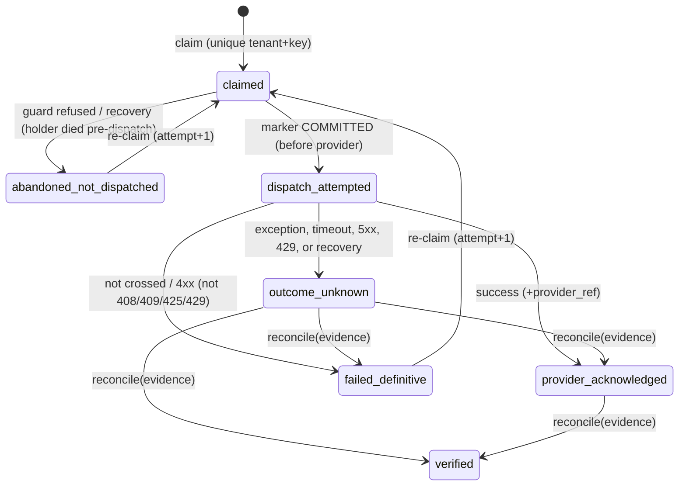

# MAX-P0-003 — Reliability Core

Status: **implemented on branch, not deployed.** P0 feature freeze respected: no new specialist capability, no tenant-authorization change, no schedule or worker enabled, no outbound sent.

## 1. Implementation summary

| Concern | Implementation | Files |
|---|---|---|
| Mission locking | Transaction-scoped **mission lease**: one dedicated connection, `BEGIN` → `pg_advisory_xact_lock` → work → `COMMIT`/`ROLLBACK`. Replaces the session-level ADR-075 lock. | `services/missionLease.js`, `packages/acquisition-mission/TransactionalPersistence.js` |
| Transaction integrity | TME stage write **and** its persisted-projection verification run inside the lease transaction; a failed verification now rolls the durable write back (previously it stayed committed while memory rolled back). | `services/acquisitionMissionPersistence.js` (`persistStageCommit`, `bindStagePersistDurable`), `packages/acquisition-mission/TransactionalExecution.js` |
| Lost-update prevention | Conditional upsert on `acquisition_missions`: same tenant, version never regresses, and (when known) the durable fingerprint (`version|updatedAt` from the payload) equals what this engine read at hydrate. | `persistMission`, `fingerprintFromPayload`, runtime `durableBaseline` |
| Tenant-scoped concurrency | Lease refuses a mission owned by another tenant; cross-tenant upsert refused (`mission_tenant_mismatch`, HTTP 404 — no disclosure). Ledger, receipts, recovery and audit are keyed by tenant. | as above + `services/maxReliability/*` |
| Durable idempotency keys / replay receipts | `max_request_receipts` (tenant, scope, key) + SHA-256 request fingerprint. `POST /api/v1/amo/missions/:id/execute` honours `Idempotency-Key`. Receipts never expire. | `services/maxReliability/requestReceipts.js`, `keyedRequest.js`, `routes/acquisitionMissions.js` |
| Atomic action claims / duplicate external-action prevention | `max_external_action_claims` (tenant, key) unique row; every AMO outbound send goes claim → dispatch marker (committed) → provider. | `services/maxReliability/externalActionLedger.js`, `guardedDispatch.js`, `packages/max/workspace/OutboundExecutionAdapter.js` |
| Interrupted execution recovery | Operator-run, tenant-scoped, plan-by-default. | `services/maxReliability/executionRecovery.js`, `scripts/max-reliability/recover.cjs` |
| Correlation IDs + redacted audit | `X-Correlation-Id` (validated or minted) on execute; `max_reliability_audit` rows for every state change, details redacted (no recipients, content or secrets; keys hashed). | `correlation.js`, `reliabilityAudit.js`, `redaction.js` |

### Architectural decisions

1. **No session-level locks on pooled connections.** The only lock primitive for missions is `pg_advisory_xact_lock` on a connection the lease owns for its entire life. It cannot outlive its transaction, so it cannot leak, and a crashed holder releases it when its socket dies.
2. **Lock identity = canonical mission id only.** Not the tenant (a wrong tenant would get a different lock) and not the version (two writers holding v3 and v4 must collide). Tenant isolation is enforced *inside* the lock.
3. **Locks serialize, CAS decides.** The lease prevents concurrent execution; the compare-and-set on the row prevents a writer with a stale snapshot (stale hydrate, lock-skipping legacy writer, another process) from overwriting. Either alone is insufficient.
4. **Both CAS sides read the JSON payload.** `missionFromRow` prefers the `updated_at` column (a timestamptz); comparing against it caused false conflicts during development (caught by the anchor PostgreSQL suites, regression test added).
5. **Exactly-once delivery is not claimed.** The ledger makes uncertainty explicit and never retries it. The dispatch marker is written on its own autocommit connection, never inside the mission lease transaction, so a crash or rollback can never erase the evidence that a send may have happened.
6. **Fail closed without the migration.** Ledger/receipt code verifies its tables exist; if not, outbound sends are recorded as blocked (`reliability_schema_missing`) and keyed requests return 503. Nothing runs unguarded.
7. **Non-PostgreSQL test doubles** (no boolean advisory-lock result) are treated as "lock skipped", the same outcome ADR-075 always gave them. Real PostgreSQL never takes that branch.

## 2. Defect reproduction (pooled-connection advisory lock)

Reproduced against the authoritative implementation (`76a1059`) before any change:

```
held by pids [ { pid: 564 } ]   after release [ { pid: 564 } ]   errs []
second-process acquire after "release": tme_transaction_overlap
```

`acquireMissionDurableLock` ran `pg_try_advisory_lock` through `pool.query`; `releaseMissionDurableLock` ran `pg_advisory_unlock` through another `pool.query`, which landed on a different pooled connection. PostgreSQL returned `false` with only a WARNING (not an error), so the code believed it had released. Consequences: (a) the lock stays on an idle pooled connection and every other process is locked out of that mission until the connection is recycled; (b) because session locks are re-entrant, the next request handed that pooled connection "acquires" the lock instantly — **mutual exclusion is bypassed**. The test `REPRODUCTION: session-level advisory lock…` pins all three behaviours on real PostgreSQL; `fixed: mission lease releases on the same connection…` shows 20 acquire/release cycles with a busy pool leave zero advisory locks.

Other session-level `pg_try_advisory_lock` users exist outside the mission path (`miraTranscriptionAgent.js`, `governedOutboundReplies.js`, `governedOutboundStore.js` line 95, `services/signalDashboard/store.js`, `packages/max/clarity/store.js`, `tenantOutreachScheduler.js` line 1015). **Not changed** (feature freeze; several are disabled workers). Those that call `pool.query` for both lock and unlock carry the same hazard and are listed in §7.

## 3. Diagrams

### 3.1 Mission lease and stage commit

```mermaid
sequenceDiagram
  participant R as Request (any process)
  participant L as Lease connection
  participant P as Pool (other conns)
  participant DB as PostgreSQL
  R->>L: connect (dedicated)
  L->>DB: BEGIN; SET LOCAL lock_timeout, idle_in_transaction_session_timeout
  L->>DB: pg_try_advisory_xact_lock(hash('amo-mission:'||id))
  alt busy
    DB-->>L: false → ROLLBACK → tme_transaction_overlap (409)
  end
  L->>DB: SELECT tenant_id … (other tenant → mission_tenant_mismatch)
  R->>P: specialist executes (claims/sends via ledger on P, autocommit)
  R->>L: SAVEPOINT; upsert mission WHERE tenant= AND version>= AND fingerprint=
  alt 0 rows
    L-->>R: mission_version_conflict → ROLLBACK (memory restored)
  end
  R->>L: write events/contributions/audit; verify projection (same txn)
  R->>L: COMMIT  (lock released by commit, on this connection)
  Note over L,DB: crash / killed backend ⇒ txn aborted ⇒ lock gone, nothing persisted
```

### 3.2 External action states



Claim on an existing key: different fingerprint → `idempotency_key_reused`; `provider_acknowledged`/`verified` → **replay** original receipt; `claimed` → `external_action_in_progress`; `dispatch_attempted`/`outcome_unknown` → `external_action_outcome_unknown`. All rejections happen before the provider.

Mapping to the directive: not dispatched = `claimed`/`abandoned_not_dispatched`; dispatch attempted = `dispatch_attempted`; provider acknowledged = `provider_acknowledged`; independently verified = `verified`; outcome unknown = `outcome_unknown`; definitively failed = `failed_definitive`.

### 3.3 Request receipts

`(none) → in_progress → completed | failed`; `in_progress → interrupted` (recovery); lock-contention refusal before execution deletes its own `in_progress` row (audited) so the client may retry. Replay of `completed`/`failed` returns the stored body with `replayed: true`; `interrupted` returns 409 `request_outcome_unknown` and is never re-run.

## 4. Database migration requirements

`migrations/2026-11-25-max-p0-003-reliability-core.sql` — **operator migration, additive, idempotent, never startup DDL**:

- `max_external_action_claims` (PK tenant_id, idempotency_key; state CHECK; dispatched states require `dispatch_attempted_at`)
- `max_request_receipts` (PK tenant_id, scope, idempotency_key)
- `max_reliability_audit` (bigserial, tenant + correlation indexes)

No existing table, column or row changes. Mission CAS uses existing columns. Order: run the migration **before** deploying the code (code fails closed without it). Rollback is `DROP TABLE` of the three, only before any row is written or after an approved export — claim rows are the duplicate-send barrier and must never be expired or truncated while the app runs. The Render production database has **not** been migrated (not authorised).

## 5. Test evidence

New suites (real disposable PostgreSQL 16, separate OS processes each with its own `pg.Pool`; `npm run test:max:reliability-core`):

| Suite | Result |
|---|---|
| `test/maxReliabilityCorePostgres.test.js` | **24/24**, 4 consecutive clean runs (before the hydrate test was added: 23/23 ×4) |
| `test/maxReliabilityOutboundAdapterPostgres.test.js` | **4/4**, 3 consecutive clean runs |

Failure injection covered: process crash holding a lease mid-write (exit 137) → no partial write, lock released; backend terminated under an open lease → `mission_lease_lost`, nothing persisted; specialist throws; failure after the durable write but before commit; lease killed during specialist execution; crash after provider dispatch before acknowledgement (exit 137) → three retries refused, recovery escalates, evidence-backed reconcile; crash after claim before dispatch → recovery abandons, single retry; provider exception / timeout / 4xx / 429 / 503 classification; pre-dispatch guard refusal; 8 competing writers in 8 processes → exactly 1 commit, 7 `mission_version_conflict`, durable row = winner; 10 identical dispatches in 10 processes → **1 provider call**; 10 identical keyed requests → 1 execution; lock timeout explicit; schema missing → fail closed.

Regression (baseline = clean worktree of `76a1059`, same container, failure sets compared by name):

| Suite | Baseline | MAX-P0-003 | New failures |
|---|---|---|---|
| `npm run test:max` | 2934 pass / 0 fail | 2934 / 0 | 0 |
| `npm run test:amo` | 498 / 46 fail | 498 / 46 | **0** (identical set; pre-existing: Places/fixture-environment) |
| `npm run test:global-smoke` | — | 10 / 0 | 0 |
| 17 PostgreSQL suites touching mission persistence (anchor scoped resume ×11, recovery approval, evidence registry, investigation acceptance, reliability recovery, legacy hydration, review-only ×2) | 182 / 2 | 182 / 2 | **0** |
| `npm run test:anchor-outbound` | see PR | see PR | see PR |

Test fixture update (no assertion weakened or removed): the `adr075TransactionalPersistence` in-memory pool hand-emulated the *old* session-lock SQL; it now emulates the lease protocol (transaction-scoped lock released at COMMIT/ROLLBACK). `spec131`/`spec206` are unchanged and pass through the non-PostgreSQL "lock skipped" path (decision 7). No baseline exception was added.

## 6. Remaining execution-safety limitations

1. **Provider-side idempotency is unverified.** Brevo receives `Idempotency-Key` as a custom header; whether Brevo deduplicates on it is not established. Safety does not depend on it: the ledger never re-dispatches an unknown outcome. Reconciliation of `outcome_unknown` currently requires evidence supplied by an operator or webhook path (`reconcile()`); an automated Brevo event matcher (by `mission:`/`prospect:` tags) is not built.
2. **Claim granularity is per message identity** (`mission + prospect + prepared revision`). A new Paige revision is a new identity; cross-mission duplicate prevention remains the governed store's job (`already_attempted` checks), unchanged.
3. **Other session-level lock users** listed in §2 retain the pooled-connection hazard (outside the mission path; most are disabled workers).
4. **Execute requests without `Idempotency-Key`** keep today's semantics (lock + CAS + ledger still apply). The UI does not send keys yet.
5. **Correlation id** is threaded to receipts, audit, ledger claims and TME input; it is not yet propagated through every router audit record (in-memory `recordRouterAudit`).
6. **Non-TME writers** without a hydrate baseline (missions created in-memory and first persisted) are protected by the lock and version non-regression only, not by fingerprint CAS, until their first write records a baseline.
7. **Lease idle bound** is 10 minutes (`idle_in_transaction_session_timeout`, per transaction). A specialist that idles longer loses the lease and its stage rolls back (sends already recorded in the ledger are not repeated).
8. **Recovery is manual** (workers disabled by directive): stale `dispatch_attempted` rows stay blocking until an operator runs `recover.cjs`. This is the safe direction.
9. Legacy pre-ledger `attempted` execution records with no outcome now block a resend (`external_action_outcome_unknown`) instead of being re-sent. Intended; may surface historic stuck items.

## 7. Updated P0 acceptance register

| # | Criterion | Status | Evidence |
|---|---|---|---|
| 1 | Concurrent identical requests → one durable mutation, one receipt | **Met** | 8-process CAS test; 10-process dispatch test; 10 concurrent keyed requests |
| 2 | Replay returns original receipt, no duplicate dispatch | **Met** | ledger replay; adapter replay restores original provider ids; keyed replay |
| 3 | Key reuse with different fingerprint rejected | **Met** | ledger `idempotency_key_reused`; keyed 422 |
| 4 | Tenant isolation for locks, receipts, claims, recovery | **Met** | lease tenant refusal; cross-tenant upsert refusal; tenant isolation test |
| 5 | No lost updates / conflicting execution | **Met** (limit §6.6) | competing-writer, stale-engine, hydrate-baseline tests |
| 6 | Timeouts, crashes, retries → explicit recoverable states | **Met** | lock timeout, crash, killed-backend, receipt interruption tests |
| 7 | Unknown outcomes never blindly retried | **Met** | crash-after-dispatch test (3 refused retries, 1 provider call) |
| 8 | Duplicate claims rejected before provider | **Met** | dispatch counters in every ledger/adapter test |
| 9 | PostgreSQL integration tests: concurrency, pooling, replay, restart, failure injection | **Met** | §5 |
| 10 | Existing suites green, no new baseline exceptions | **Met locally**; CI pending | §5 |
| — | Production database compatibility | **Open** | §8: Render DB unreachable from this session by design |
| — | MAX-P0-002 production configuration verification | **Open** (carried) | §8 |

## 8. Parallel verification (§4) — findings

**Access.** The Render database `pulseforge-production-migration` (`dpg-dbtgtloae00c73dd8040-a`, PostgreSQL 18, Ohio, 1c-2g, 10 GB, no HA, no replica) has an **empty IP allowlist**: it accepts no external connections, so the Render MCP read-only query tool cannot reach it. Adding an allowlist entry would expose it and is outside this authorisation. No in-network read path exists in this session (no SSH key for the service; the cutover's in-network component is a restore receiver, not a reporter). **The live schema report was therefore not executed.** `scripts/max-reliability/schemaReport.cjs` is ready: run it in **Render Shell** on `pulseforge-api-migration` (private network, existing `DATABASE_URL`); it uses one `REPEATABLE READ READ ONLY` transaction, a 20 s statement timeout, and emits counts/catalog only (verified locally: `transaction_read_only = on`).

**Escalation — public pgAdmin.** Render service `pgAdmin-dpg-dbtgtloae00c73dd8040-a` (created 2026-11-24, `ipAllowList 0.0.0.0/0`, public URL) is attached to the production database. That is a public administrative path to production data, contrary to "do not expose PostgreSQL publicly". **Not modified** (no authority). Recommend suspending it or restricting its allowlist today.

**Deployment branch.** Render `pulseforge-api-migration` deploys branch `migration/render-current-main` with auto-deploy **off**; `main` is `76a1059`. This branch (MAX-P0-003) is cut from `76a1059`. Reconciliation path: PR to `main`; then a reviewed fast-forward/merge of `main` into `migration/render-current-main`. Divergence between `migration/render-current-main` and `main` could not be inspected from this session (only this repository's `main` and the work branch are fetched); check with `git log main..migration/render-current-main` before the merge.

**Railway vs Render divergence.** No Pulseforge project is visible in the accessible Railway workspace (consistent with commit `3c4aed6`, "retire Railway DB after verified promotion"). Live comparison is impossible. Recorded evidence (`docs/migration/CUTOVER_EXECUTION_20261122.md`): production-data rehearsal **0 differences** across 274 tables / 1,630,980 rows, catalog identical (319 tables, 3 views, 80 triggers, 779 indexes, 3,629 constraints, 84 functions, 56 sequences), 45 Signal tables intentionally empty; final cutover promoted the verified copy by rename, keeping `pulseforge_pre_cutover_<stamp>`. Off-Railway copy: GitHub artifact `14765103365` (90-day retention, from 2026-11-22 → expires ≈ 2027-02-20). **Writes after the 18:49Z unfreeze** were re-snapshotted (`4e8b1c8`, `d134540`); confirming no Railway write landed after the final snapshot requires the Railway audit/log which is not reachable here.

**Database reconciliation plan (no destructive step proposed).** (1) Run `schemaReport.cjs` in Render Shell; compare `catalog` with the rehearsal catalog above and `missingFromMigrations` with expectations (tables created by startup `ensure*` code rather than migrations will legitimately differ). (2) If `pulseforge_pre_cutover_*` still exists, run the same report against it read-only and diff row counts for the 274 tables. (3) Any discrepancy → write up, no restore; a restore/replace needs separate approval. (4) Apply `2026-11-25-max-p0-003-reliability-core.sql` only under its own approval.

**Max model-provider requirements, by execution path (reconciles the Anthropic/Gemini conflict).** Both prior findings were partly right: Max has *different* providers on different paths, and the core workspace needs **neither**.

| Path | Provider | Required? | Config |
|---|---|---|---|
| Max workspace / AMO / missions / approvals / execution router / TME / this reliability core | none (deterministic) | — | — |
| Workspace answer phrasing (`PresentationEngine`) | **Gemini** | Optional — deterministic fallback when absent or failing (`presentation: fallback_error`) | `GEMINI_API_KEY`, `MAX_PRESENTATION_MODEL` (default `gemini-3.1-flash-lite`) |
| Legacy dashboard chat `POST /api/max/ask` (`routes/maxChat.js`) | **Anthropic** | Required for that endpoint (500 without it) | `ANTHROPIC_API_KEY`, `MAX_CHAT_MODEL` (default `claude-sonnet-4-6`) |
| Daily Max briefing (`maxAgent.js`, cron) | **Anthropic** | Required for briefing insights | `ANTHROPIC_API_KEY` (model pinned `claude-sonnet-4-6`) |
| Semantic interpretation shadow | Anthropic (default) or Gemini | Off unless `MAX_INTERPRETATION_SHADOW=true`; model has no default | `MAX_INTERPRETATION_PROVIDER`, `MAX_INTERPRETATION_MODEL`, matching key |
| Paige copy (outbound content) | Anthropic | Required for Paige | `ANTHROPIC_API_KEY` |

**Render environment names required for Max** (names only; values not read): `DATABASE_URL`, `SESSION_SECRET`, `CRON_SECRET`, `APP_URL`, `DASHBOARD_URL`, `ANTHROPIC_API_KEY`, optional `GEMINI_API_KEY`/`MAX_PRESENTATION_MODEL`/`MAX_CHAT_MODEL`; flags `PF_DISABLE_BACKGROUND_WORKERS` (must stay set — workers off), `PF_MIGRATION_RECEIVER=0`, `MISSION_STORE_ALLOW_EPHEMERAL` (must be **unset**), `MAX_CONVERSATION_CONTEXT`, `MAX_CONVERSATION_LEDGER`, `MAX_GATE_BOUND_APPROVAL`, `MAX_OPERATIONAL_READ_PRECEDENCE`, `MAX_FRAME_REASONING` (keep off), `MAX_INTERPRETATION_SHADOW` (keep off), `SCOUT_RESEARCH_ONLY_GRANTS_ENABLED` (keep off). The Render MCP exposes no read of a service's variable names, so presence was not verified; the 153-name Railway inventory in the cutover record is the comparison list.

## 9. Proposed controlled deployment and verification plan

Gate 0 (before any deploy): PR CI green; pgAdmin exposure resolved; schema report run in Render Shell and reviewed; MAX-P0-002 configuration items closed.

1. **Migration** (separate approval): in Render Shell, `psql "$DATABASE_URL" -f migrations/2026-11-25-max-p0-003-reliability-core.sql`; re-run `schemaReport.cjs` → `reliabilityCoreInstalled: true`, nothing else changed.
2. **Branch**: merge PR to `main`; reviewed merge of `main` into `migration/render-current-main`; manual deploy (auto-deploy stays off) with `PF_DISABLE_BACKGROUND_WORKERS` unchanged, cron-job.org jobs still paused.
3. **Smoke (read-only, no outbound):** `/healthz`; login; `GET /api/v1/amo/missions` for tenant 10; `node scripts/max-reliability/recover.cjs --tenant 10` (plan) → zero stale rows; `--unresolved` → empty.
4. **Lock verification in production, no mutation:** `SELECT count(*) FROM pg_locks WHERE locktype='advisory'` before/after a read-only Max session → no residual mission locks.
5. **First keyed execute** only on a test/dev-classified mission with a non-outbound intent and `Idempotency-Key`; send it twice → second response `replayed: true`; audit rows present with the correlation id, redacted.
6. Outbound remains disabled. Enabling any send path is a separate decision; when taken, the first send must be observed end-to-end in `max_external_action_claims` (`claimed → dispatch_attempted → provider_acknowledged`).
7. **Rollback:** redeploy the previous commit (the new tables are inert to old code); leave the tables in place.
